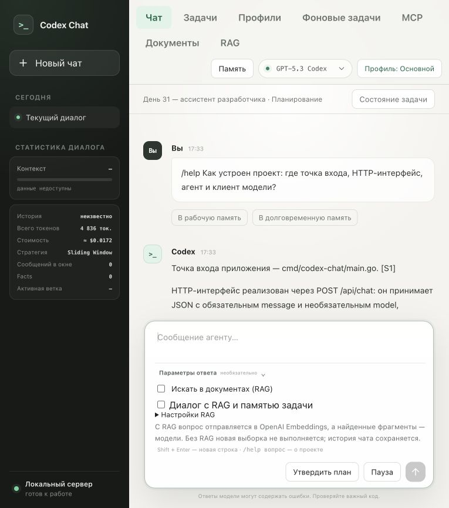
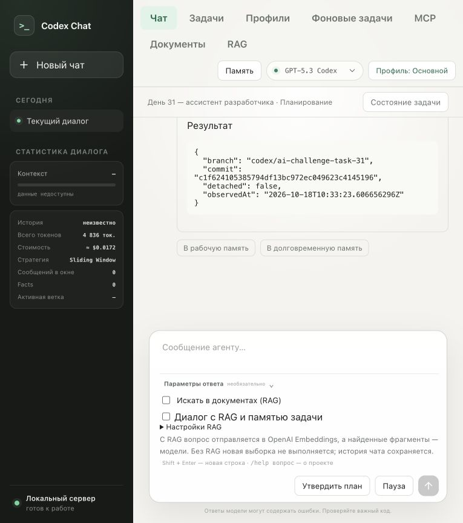

# День 31: ассистент разработчика codex_chat_cli

Проверено 18 октября 2026 года в Docker на `http://127.0.0.1:8080`.
Модель: `gpt-5.3-codex`, реальные платные запросы OpenAI, разрешённые пользователем.

## Реализация

- `/help вопрос` использует отдельный локальный BM25-индекс README, четырёх документов `docs/` и выбранных корневых инструкций: **14 документов, 135 чанков**. Разбиение по Markdown-заголовкам, размер до 1600 символов, перекрытие 180. Сохраняются путь, раздел, ID, смещения и SHA-256. Эмбеддинги для этого режима не требуются.
- До четырёх фрагментов документации, не более двух из одного файла, бюджет 6800 символов. Учитываются совпадения заголовков и небольшое расширение русских терминов. Это лексический поиск, а не семантический embedding-поиск.
- Настоящий Project MCP на существующем Go SDK: Streamable HTTP, обнаружение инструментов и `tools/call`. `git_branch` читает текущую ветку/HEAD, `project_files` — до 160 отслеживаемых публичных путей. Git вызывается с фиксированными аргументами, без shell; произвольные команды и изменения не поддерживаются.
- Каждый вопрос заново получает Git через MCP. В ответе источники документов и `mcp://codex-project-mcp/...` различаются. При ошибке MCP документация остаётся доступной, текущее Git-состояние не выдумывается.
- Ответ формируется через существующий строгий RAG: утверждения с диапазонами строк, восстановление точных цитат и отдельная проверка поддержки утверждений моделью. Непроверенный черновик не сохраняется.
- `/help` изолирован от учебного корпуса, скрытой цепочки Responses API, истории/памяти задач и инструментов брокера/планировщика. Сообщения и источники сохраняются в текущей истории. `/help` без вопроса показывает справку без LLM-вызова.

## Контрольный прогон

[10 вопросов, ожидания и требуемые источники](../../docs/help-questions.json) не передавались отвечающей модели. JSON с эталонами не индексируется. Каждый вопрос выполнялся в отдельной браузерной сессии через `POST /api/chat`.

| Вопрос | Проверяемое поведение | Итог |
|---|---|---|
| H01 | Точка входа, web, agent, OpenAI-клиент | Все четыре компонента названы; консервативный статус partial |
| H02 | Docker, ключ в .env, адрес чата | Инструкция запуска и порт 8080 |
| H03 | POST /api/chat, message, поля ответа | Подтверждено документацией API |
| H04 | Облачная генерация и ключ на сервере | OpenAI, ключ не передаётся браузеру |
| H05 | Индексация, обычный RAG, SQLite | Правильные пакеты и формат |
| H06 | Три слоя памяти, новая задача | Слои и сохранение профиля названы |
| H07 | Стратегии контекста и N | Четыре стратегии, N=10 |
| H08 | Текущая ветка и HEAD | Точное совпадение с checkout через MCP |
| H09 | Инструменты MCP и запрет изменений | git_branch, project_files, нет записи и произвольных команд |
| H10 | SLA неописанного Kubernetes-кластера | unknown, «не знаю» и просьба уточнить |

**Финальный прогон: 10/10 автоматических проверок; 8 answered, 1 partial, 1 unknown.**
У всех девяти содержательных ответов есть источники и точные цитаты, все опубликованные утверждения прошли проверку поддержки. У корректного unknown нет вымышленных источников/цитат. Результаты и цитаты также прочитаны вручную; H01 содержит запрошенные компоненты, но проверяющая модель перестраховалась и пометила ответ как partial.

Медиана полного HTTP-запроса — **4,08 с**, суммарно 41,26 с на 10 вопросов. 35 086 LLM-токенов, 19 вызовов модели: девять ответов с проверкой и один unknown без отдельной проверки утверждений. По встроенному прайс-листу приложения ориентировочная стоимость финального прогона — $0,095; это оценка, не счёт провайдера.

[Финальные запросы, ответы, метрики, источники и проверки](verified/results.json).

Первый прогон сохранён без перезаписи: [исходные результаты](results.json), 8/10 автоматических проверок. H02 нашёл раздел о mock-сервисе вместо основной Docker-инструкции; после усиления совпадений заголовков и расширения «запустить → запуск» в финальном прогоне выбран правильный раздел. Добавлен регрессионный тест. H09 был корректен уже в первом прогоне, но буквальная эвристика ожидала «чтение»; проверка ключевых фактов расширена на эквивалентное упоминание запрета произвольных команд. Текст вопроса и смысл ожиданий не менялись; старые условия и оценки сохранены внутри исходного отчёта. Поэтому две итоговые автоматические оценки нельзя считать чистым экспериментом с неизменным оценщиком.

## Проверки кода и Docker

`go test -race ./...`, `go vet ./...` — успешно. После изменения ранжирования повторены race-тесты затронутых пакетов и vet. Docker-сборка запускает полный набор Go-тестов, включая реальные MCP-вызовы к временному Git-репозиторию. Проверены unborn/detached HEAD, смена ветки без перезапуска, запрет лишних аргументов, отзыв разрешений, обновление документации, защита от symlink/невалидного UTF-8 и восстановление источников из JSON-истории. Python/JS syntax и `git diff --check` — успешно.

Сервисы запущены. Project MCP имеет read-only root, непривилегированного пользователя и единственный read-only mount `.git`; API-ключа OpenAI и опубликованного порта у него нет. Приложение читает README/docs через read-only mounts, индекс сохраняется в томе `/data`.

[Снимок построенного индекса](project-index.json), [среда, ограничения и отпечаток исходников](environment.json). На момент прогона HEAD — `c1f624105385794df13bc972ec049623c4145196`, ветка — `codex/ai-challenge-task-31`; реализация находилась в рабочем дереве. Отпечаток исходников фиксирует проверенный код независимо от последующего коммита.

После прогона по запросу пользователя создана ветка `ai-challenge-task-31` для PR. Исторические JSON и скриншоты сохранены с фактическим именем ветки на момент проверки; MCP продолжает читать текущий checkout без пересборки.

## Веб-интерфейс

В отдельной задаче «День 31 — ассистент разработчика» отправлен вопрос о структуре проекта. Получены компоненты проекта, источники, цитаты и успешный MCP git_branch. Предыдущая задача и её история сохранены.





## Повторение

```sh
docker compose up -d --build
python3 scripts/evaluate-help.py --output artifacts/help31-another
```

Повторный прогон платный. Для продолжения прерванного прогона есть `--resume`; оно проверяет dataset, HEAD, ветку, URL и выбранную модель. Результаты не перезаписываются без явного выбора нового каталога. JSON-эвристики и проверка той же моделью не гарантируют отсутствие всех смысловых ошибок. В Docker проверен обычный checkout с каталогом `.git`; для linked worktree требуется настройка mounts, описанная в `docs/development.md`.
